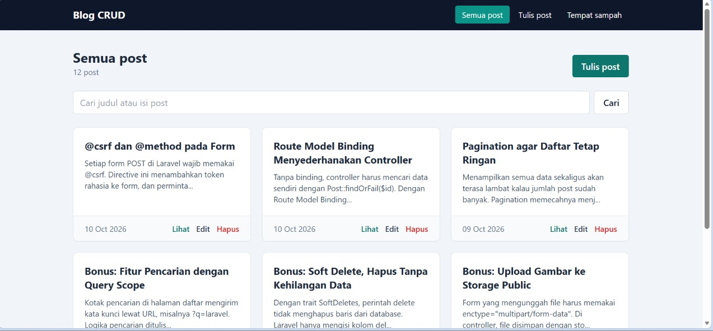
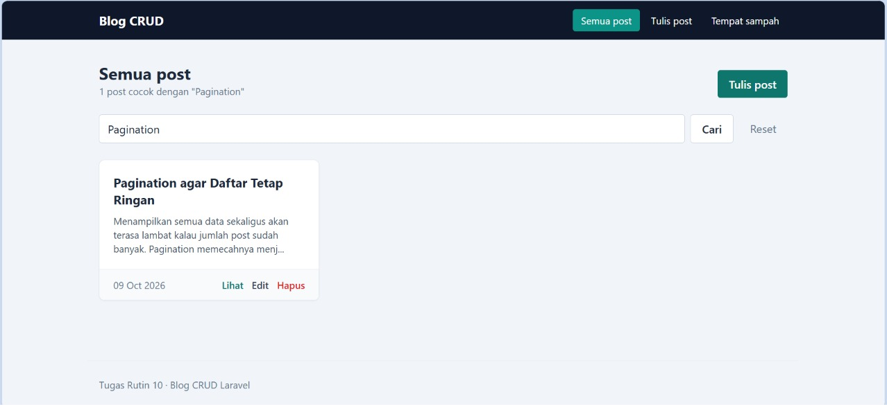
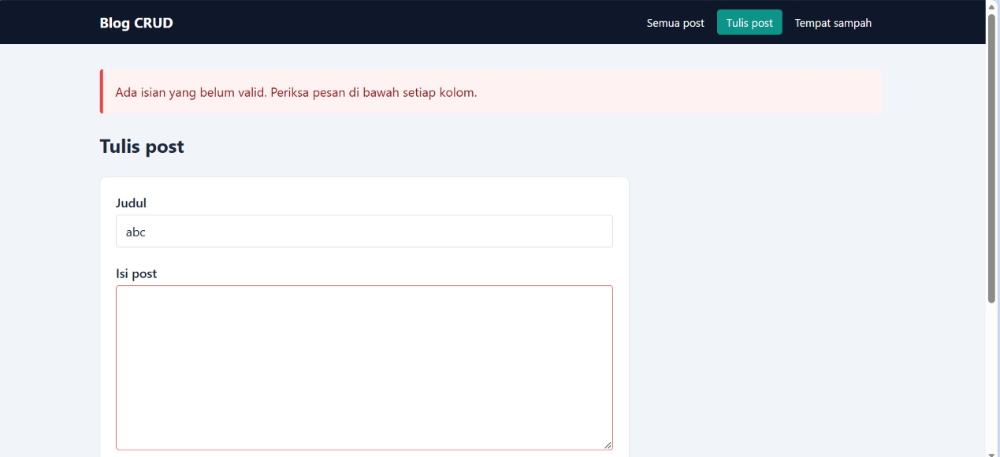
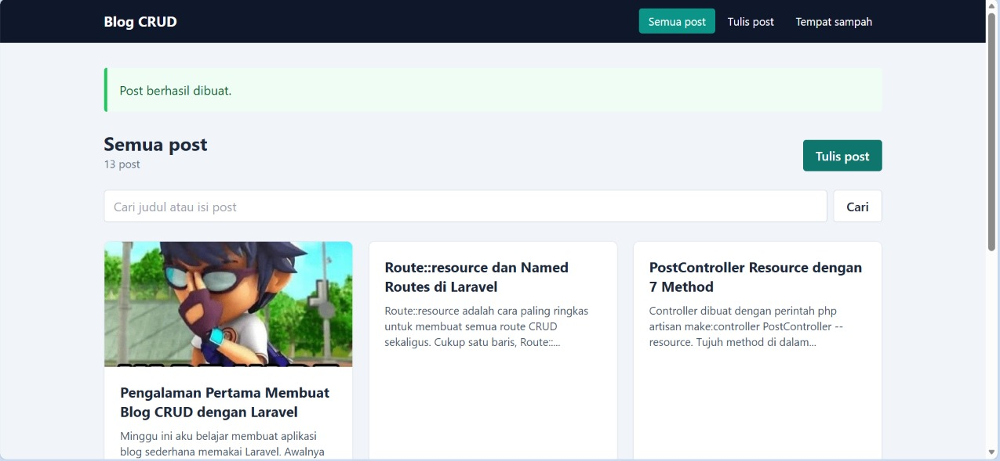
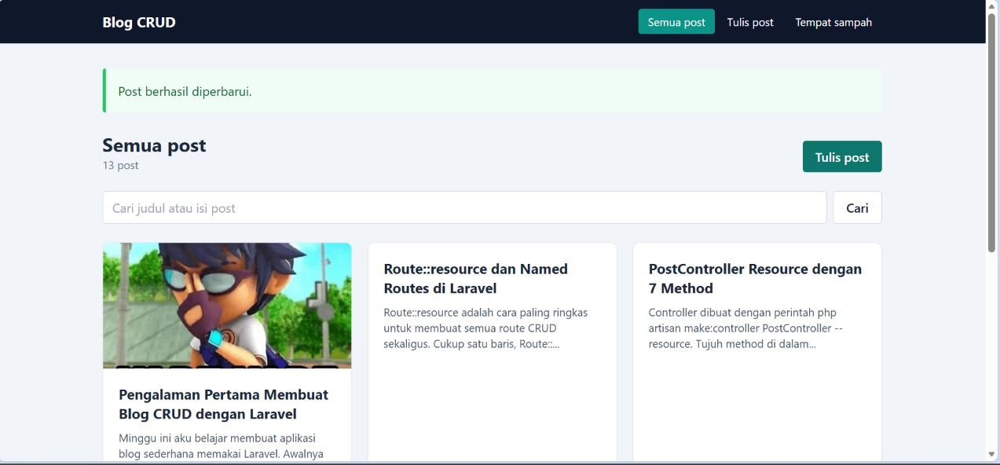
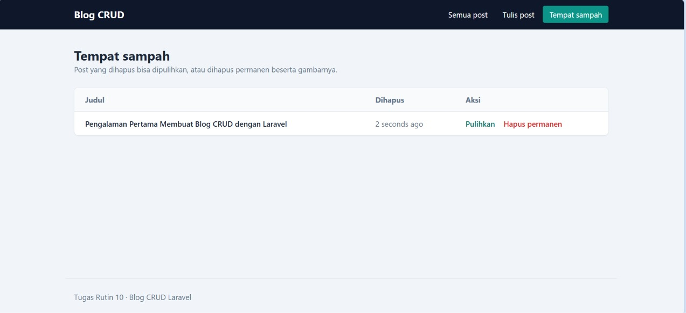

# Blog CRUD Laravel - Tugas Rutin 10

Aplikasi blog sederhana dengan operasi CRUD lengkap (Create, Read, Update, Delete) memakai Laravel 12, MySQL, dan Tailwind CSS.

## Fitur

**Requirement**
1. `Route::resource('posts', PostController::class)` dengan named routes
2. `PostController` resource dengan 7 method (index, create, store, show, edit, update, destroy)
3. Blade layout master (`layouts/app.blade.php`) dengan `@extends` dan `@yield`
4. 2 Blade component: `<x-alert>` dan `<x-card>`
5. Validasi lewat Form Request, pesan error per field, dan `old()` input
6. Flash message sukses dan gagal
7. `@csrf` di semua form, serta `@method('PUT')` dan `@method('DELETE')`
8. Route Model Binding dan pagination (6 post per halaman)

**Bonus**
- Pencarian post berdasarkan judul dan isi
- Soft delete, dengan halaman tempat sampah (pulihkan atau hapus permanen)
- Upload gambar (disimpan di `storage/app/public/posts`)

## Cara menjalankan

1. Pastikan PHP 8.2+, Composer, dan MySQL (misalnya XAMPP) sudah aktif.
2. Clone repo ini lalu masuk ke foldernya:
   ```
   git clone https://github.com/pelitayesy-spec/TugasWeb-P10-BlogCRUD.git
   cd TugasWeb-P10-BlogCRUD
   ```
3. Install dependensi dan siapkan konfigurasi:
   ```
   composer install
   copy .env.example .env
   php artisan key:generate
   ```
4. Buat database `blog_crud` di phpMyAdmin, lalu atur bagian database di `.env`:
   ```
   DB_CONNECTION=mysql
   DB_HOST=127.0.0.1
   DB_PORT=3306
   DB_DATABASE=blog_crud
   DB_USERNAME=root
   DB_PASSWORD=
   ```
5. Buat tabel dan isi data contoh:
   ```
   php artisan migrate --seed --seeder=PostSeeder
   ```
6. Hubungkan folder upload gambar:
   ```
   php artisan storage:link
   ```
7. Jalankan server:
   ```
   php artisan serve
   ```
   Lalu buka http://127.0.0.1:8000

## Struktur penting

```
app/Models/Post.php                        # model, SoftDeletes, scope pencarian
app/Http/Controllers/PostController.php    # 7 method resource + trash, restore, forceDestroy
app/Http/Requests/PostRequest.php          # aturan validasi dan pesan error
database/migrations/..._create_posts_table.php
database/seeders/PostSeeder.php            # 12 artikel contoh
resources/views/layouts/app.blade.php      # layout master
resources/views/components/                # alert dan card
resources/views/posts/                     # index, create, edit, show, trash, _form
routes/web.php                             # Route::resource + route soft delete
```

## Screenshot

### Daftar post dan pagination


### Pencarian


### Validasi dengan error per field


### Flash message sukses


### Edit post (form terisi data lama)


### Tempat sampah (soft delete)
